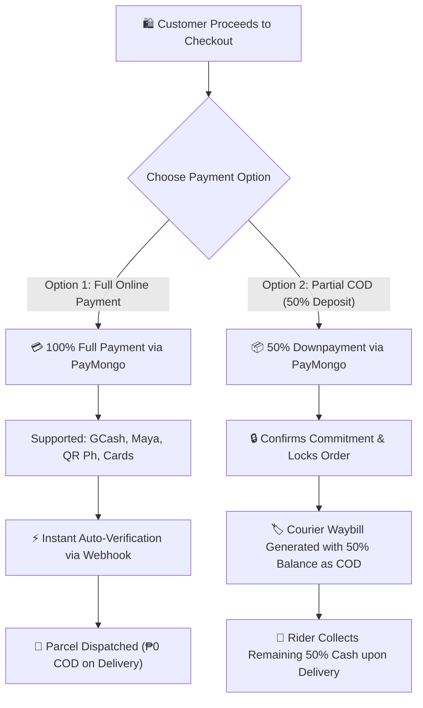

# 💳 P&R Storefront Payment Architecture & Partial COD Strategy

---

## 📌 Executive Summary

This document details the strategic payment architecture for **P&R Streetwear Storefront**, covering the transition to **automated payment processing via PayMongo** and the implementation of a **50% Partial Cash-on-Delivery (COD) / Commitment Deposit model** tailored for 1-of-1 curated streetwear drops in the Philippines.

---

## 🎯 Strategic Objectives

1. **Eliminate Manual Audits:** Replace manual GCash screenshot uploads and 13-digit reference number verification with automated PayMongo webhooks.
2. **Zero RTS (Return-To-Sender) / Joy Miner Losses:** Protect 1-of-1 archival inventory from getting locked in courier warehouses due to fake or unaccepted COD orders.
3. **Frictionless Shopper Experience:** Built-in gateway transaction fees directly into garment retail pricing to prevent cart abandonment caused by surprise checkout fees.

---

## 🏗️ 2-Tier Payment Framework

---

## 1️⃣ Strategy 1: Full Online Payment (100% Upfront)

* **Methods Supported:** GCash, Maya, GrabPay, QR Ph, BDO/BPI Online, Visa/Mastercard.
* **Customer Payment Upfront:** **100% of Total Order Amount**.
* **Payment on Delivery:** **₱0.00** *(Rider simply hands over the package with signature)*.
* **Verification Process:** Instantaneous via PayMongo Webhooks (`payment.paid` event triggers `payment_verified` status automatically).

---

## 2️⃣ Strategy 2: Partial COD (50% Commitment Downpayment)

### 🛡️ Why 50% Downpayment is Essential for 1-of-1 Streetwear:
* **High RTS Protection:** Pure 100% COD in the Philippines carries an average RTS (Return-to-Sender) failure rate of 15% to 30%. Because P&R sells 1-of-1 curated garments, an RTS order traps the single unique piece in transit for 10–14 days.
* **Guaranteed Expense Recovery:** A 50% upfront deposit covers 100% of courier shipping fees (₱99–₱160) and premium pouch packaging, ensuring the store is never left with out-of-pocket losses.
* **Customer Delivery Collection:** The remaining 50% balance is declared as the **COD Collection Amount** on the J&T Express / courier waybill.

---

## 3️⃣ Built-in Transaction Fee Pricing Model

### 💡 Core Rule: *What You See Is What You Pay*
Do **NOT** add surprise gateway processing fees on top at the final checkout step. Instead, absorb the standard payment processing fee (~2.5% to 3.5%) directly into the product margin.

### 📐 Net Payout Formula:
$$\text{Net Payout to Seller Bank} = \text{Total Amount Paid by Customer} - \text{Gateway / Courier Fee}$$

---

## 📊 Concrete Numerical Example

**Scenario Cart:**
* **Item 1:** ₱100.00
* **Item 2:** ₱300.00
* **Subtotal:** ₱400.00
* **Courier Shipping (Metro Manila):** ₱99.00
* **🔥 Total Order Amount:** **₱499.00**

---

### Comparison Breakdown Table:

| Metric / Step | Option A: Full Online Payment | Option B: Partial COD (50% Deposit) |
| :--- | :--- | :--- |
| **Upfront Payment (Online)** | **₱499.00** *(100% Full)* | **₱250.00** *(50% Downpayment)* |
| **COD Balance (Paid to Rider)** | **₱0.00** | **₱249.00** *(50% Balance)* |
| **Declared COD on J&T Waybill** | ₱0.00 *(Non-COD Parcel)* | **₱249.00** |
| **Gateway / Courier Fee** | ~₱12.48 *(PayMongo 2.5%)* | ~₱6.25 *(PayMongo)* + ~₱5.00 *(J&T COD 2%)* |
| **Net Store Payout** | **₱486.52** | **₱487.75** *(₱243.75 upfront + ₱244.00 COD remittance)* |
| **RTS Risk** | **0% (Paid in Full)** | **Near 0% (Buyer committed 50% deposit)** |

---

## 🚀 Technical Implementation Checklist

- [ ] **Checkout Page UI (`CheckoutModal.tsx` / `CheckoutPage.tsx`):**
  - Add radio selector: `100% Full Payment (Fastest Dispatch)` vs `50% Partial COD (Pay 50% now, balance on delivery)`.
  - Dynamically display the **Upfront Amount** vs **Balance upon Delivery** breakdown.
- [ ] **Backend Webhook Integration (`backend/src/routes/paymentRoutes.ts`):**
  - Integrate PayMongo Payment Intent API for GCash, Maya, and QR Ph.
  - Implement webhook listener for auto-updating order status to `payment_verified`.
- [ ] **Admin Waybill Management (`AdminDispatchSection.tsx`):**
  - Auto-populate waybill COD collection amount (₱0 for Full Online, 50% balance for Partial COD).
