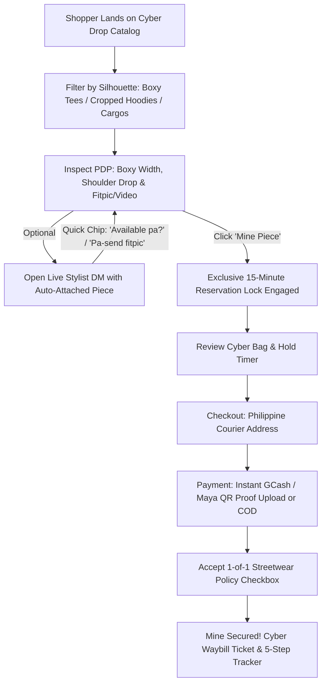

# P&R Streetwear & Style Collection — Shopper Architecture & System Specification
**Version:** 2.1.0 (Modern Streetwear, Cyber-Style & Anti-AI-Slop Human-Crafted Architecture)  
**Target Platform:** Mobile-First Web & Responsive Desktop  
**Niche:** Curated Modern Streetwear, Drop-Shoulder Silhouettes, Heavy Boxy Apparel & 1-of-1 Cyber Drops  
**Author:** Software Architecture & Frontend Engineering Team  

---

## 1. Brand Identity & Design Tokens

### 1.1 Brand Philosophy
"**P&R Streetwear & Style Collection**" is an ultra-curated contemporary streetwear archive and drop storefront. Stripping away outdated rustic vintage clichés and generic AI boilerplate, the platform embodies **Modern Streetwear & Cyber-Style**—fusing brutalist techwear ergonomics, boxy tailoring culture, high-density fabrics (240+ GSM), and exclusive 1-of-1 curation. Every release is treated as a limited cyber-drop with instant 15-minute inventory locks, live DM fitpic concierge, and dark-mode digital waybill manifests.

### 1.2 Theme & Visual Archetype
* **Aesthetic:** Modern Curated Streetwear, Cyber-Style & Tactical Brutalism.
* **Layout Paradigm:** Dark Obsidian canvas, layered glassmorphism, crisp 1px brutalist micro-borders, razor-sharp edge radiuses, fluid touch drawer gestures, and high-frequency monospace drop counters.
* **Atmosphere:** Deep Obsidian (`#0A0A0C` to `#121214`), Tactical Zinc (`#18181B` / `#27272A`), Chrome Highlights, and Amber Flame Glow (`#F59E0B` to `#D97706` derived from the official P&R monogram).

### 1.3 Color Palette & CSS Tokens

```css
:root {
  /* Brand Primary & Cyber Amber Glow (Derived from P&R Monogram) */
  --color-brand-amber:       #F59E0B;  /* Cyber Gold / Vivid Amber */
  --color-brand-orange:      #D97706;  /* Deep Industrial Gold */
  --color-brand-amber-glow:  rgba(245, 158, 11, 0.25);
  --color-brand-amber-dim:   rgba(245, 158, 11, 0.08);

  /* Cyber Dark Base & Layered Glassmorphism Surfaces */
  --color-bg-base:           #0A0A0C;  /* Deep Obsidian Void */
  --color-bg-surface:        #121214;  /* Primary Card Surface */
  --color-bg-elevated:       #18181B;  /* Zinc 900 - Drawer & Modal Base */
  --color-bg-hover:          #27272A;  /* Zinc 800 - Interactive Fills */
  --color-bg-glass:          rgba(18, 18, 20, 0.85); /* Blurred Glass Sheet */

  /* Brutalist Micro-Borders & Delimiters (Strict 1px Definition) */
  --color-border-subtle:     #27272A;  /* Zinc 800 - 1px Structural Lines */
  --color-border-strong:     #3F3F46;  /* Zinc 700 - Focus / Active State */
  --color-border-accent:     #F59E0B;  /* Highlight Neon Amber Edge */

  /* High-Contrast Typography & Ink */
  --color-text-primary:      #FAFAFA;  /* Zinc 50 - Crisp Stark White */
  --color-text-secondary:    #A1A1AA;  /* Zinc 400 - Subtext & Fit Notes */
  --color-text-muted:        #71717A;  /* Zinc 500 - Monospace Specs / Placeholders */
  --color-text-inverse:      #0A0A0C;

  /* Tactical Badges & Drop Status */
  --color-status-sold-bg:    #18181B;  /* Muted Slate/Zinc Scrim */
  --color-status-sold-text:  #EF4444;  /* Crimson Red Alert */
  --color-status-hold:       #EA580C;  /* 15-Min Hold Orange Glow */
  --color-status-verified:   #10B981;  /* Emerald Matrix Green */

  /* Gradients & Scrims (Targeted & Purposeful) */
  --gradient-cyber-amber:    linear-gradient(135deg, #F59E0B 0%, #D97706 100%);
  --gradient-chrome-surface: linear-gradient(180deg, rgba(39, 39, 42, 0.4) 0%, rgba(18, 18, 20, 0.95) 100%);
  --gradient-scrim-pdp:      linear-gradient(180deg, rgba(10, 10, 12, 0) 50%, rgba(10, 10, 12, 0.95) 100%);

  /* Micro-Interactions & Elevations */
  --shadow-cyber-sm:         0 1px 3px rgba(0, 0, 0, 0.5);
  --shadow-cyber-md:         0 4px 16px -2px rgba(0, 0, 0, 0.7);
  --shadow-dock:             0 -4px 25px rgba(0, 0, 0, 0.85);

  /* Border Radii */
  --radius-xs:  4px;
  --radius-sm:  8px;
  --radius-md:  12px;
  --radius-lg:  16px;
  --radius-pill: 9999px;
}
```

---

## 2. Anti-AI-Slop & Human-Crafted UI Standards

To ensure the storefront reflects authentic high-fashion streetwear curation (inspired by Dover Street Market, Ssense, Fear of God, and Highsnobiety), the codebase and UI must strictly adhere to the following human-engineered styling standards:

### 2.1 🚫 Strict Prohibition of Generic AI Boilerplate
* **NO Generic AI Gradients:** Strictly avoid generic purple, violet, indigo, or rainbow pastel gradients (`bg-gradient-to-r from-purple-500 to-indigo-500`). Use only our intentional **Amber/Industrial Gold** accents on deep obsidian.
* **NO Icon Clutter:** Avoid scattering generic Lucide icons inside colored circular bubbles. Icons must be monochrome, lightweight, and placed only where functionally necessary (e.g., cart, search, ruler).
* **NO Cheesy 3D Shadows & Artificial Blobs:** Eliminate oversized, blurry colored drop-shadows that look like AI mockup templates. Use crisp, physical 1px micro-borders (`border-zinc-800` / `border-white/10`) instead.
* **NO Generic AI Copy:** Eliminate vague corporate filler copy (e.g., *"Discover our curated collection crafted just for you"*). Use authentic local streetwear drop terminology (*"DROP 08 ARCHIVE"*, *"260 GSM Drop-Shoulder Boxy Fit"*, *"Mine Piece"*, *"15-Min Bag Reservation"*).

### 2.2 📐 Streetwear Editorial & Brutalist Engineering Directives
1. **Borders & Line Definition:**
   - Every card, modal, and drawer relies on clean, high-contrast 1px micro-borders (`border-zinc-800` or `border-zinc-700/60`).
   - Hover states should trigger subtle border illumination (`hover:border-zinc-500` or `hover:border-amber-500/50`) with no jitter.
2. **Color Restraint:**
   - The UI is 90% Obsidian/Zinc dark tones (`#0A0A0C`, `#121214`, `#18181B`).
   - Amber Gold (`#F59E0B`) is reserved **strictly** for high-priority interactive touchpoints: Primary CTA ("Mine Piece"), live 15-min countdown pulse, active filter pill, and 1-of-1 verification badges.
3. **Typography Rhythms:**
   - Headlines use tight negative tracking (`tracking-tighter` / `tracking-tight`) with bold geometric structure (`Space Grotesk` or `Plus Jakarta Sans`).
   - Technical metadata (pit-to-pit dimensions, SKU codes, order hashes, waybills, and timestamps) strictly use **clean tabular monospace** (`font-mono text-xs text-zinc-400`).
4. **Snappy Micro-Interactions:**
   - Transitions must be fast and tactile (`transition-all duration-150 ease-out`).
   - Button presses include subtle physical depression (`active:scale-[0.98]`).
5. **Asymmetry & Realism:**
   - Editorial grid layouts that give prominence to garment photography drape, raw measurement specs (W x L in inches), and on-body fitpic previews.

---

## 3. Complete Shopper Journey & Screens Breakdown



---

### 3.1 Header & Global Navigation
* **Live Cyber Drop Ticker:** Glitch/marquee top status bar announcing drop drops and courier cutoff times (*"DROP 08 LIVE: Heavy Boxy Tees & Parachute Cargos · 1-of-1 Curated · Metro Manila Same-Day Available"*).
* **Brand Masthead:**
  * **P&R Monogram & Wordmark:** Bold geometric logo featuring the amber neon status dot.
  * **Drop Search Trigger:** Hotkey (`⌘K` / `Ctrl+K`) search modal with fuzzy matching across brand, silhouette descriptors, GSM weight, and sizes.
  * **Vault Wishlist Counter:** Minimalist bookmark trigger with local numerical counter.
  * **Dynamic Bag Trigger:** Live bag badge with amber glowing halo when an active 15-minute hold timer is ticking down.

---

### 3.1 Social OAuth Authentication & Anti-Fraud Shopper Pass
* **Google & Facebook 1-Click Social Sign-In / Sign-Up:**
  * Replaces complex credential forms with official **"Continue with Google"** and **"Continue with Facebook"** OAuth handshakes.
  * Verified extraction of customer profile (Full Name, verified Email, avatar photo).
* **Anti-Joy Miner / Anti-Fraud Identity Security:**
  * Grants verified social users priority 15-minute drop locks and 1-click address auto-fill.
  * Prevents dummy/throwaway accounts from submitting fake COD orders.
* **Persistent Member Session & Profile Dock:**
  * Header dropdown showing connected Google/Facebook identity, avatar, and sign-out controls.
  * Dedicated `/login` route & global `AuthModal` popup.

---

### 3.2 Drop Catalog / Homepage ("The Digital Racks")
* **Drop Billboard Spotlight:** High-contrast dark cyberpunk hero banner displaying active drop countdown, total curated inventory count, and remaining available pieces.
* **Modern Silhouette Category Pills:**
  * `All Drops` (Full curated collection)
  * `Boxy Tees` (Drop-shoulder, heavyweight 240+ GSM, boxy wide chest)
  * `Cropped Hoodies` (Wide chest, cropped bottom hem, heavyweight French terry/fleece)
  * `Parachute & Cargo Pants` (Nylon ripstop, balloon wide-leg, tactical strap cargos)
  * `Techwear & Outerwear` (Cropped bombers, tactical zip vests, shell jackets)
  * `Accessories` (Unstructured caps, tactical mini-slings, chrome chains)
* **Tactical Filter Toolbar:**
  * Silhouette fit filter (`Drop Shoulder Boxy`, `Ultra-Cropped`, `Straight Wide-Leg`, `Oversized Balloon`).
  * Size selector (`S`, `M`, `L`, `XL`, `XXL+`).
  * Price sorting & toggle for `"Hide Claimed / Sold Pieces"`.
* **2-Column Mobile / 4-Column Desktop Cyber Grid:**
  * **1-of-1 Curated Amber Badge:** Shimmering gold/amber tag on the top-left of each photo card.
  * **Tailoring Badges:** Micro-pills for `"BOXY FIT"`, `"260 GSM"`, `"CROPPED"`.
  * **4:5 Streetwear Aspect Ratio:** Crisp vertical frame highlighting full silhouette drape.
  * **Claimed / Sold Out State:** Grayed out with bold diagonal glowing crimson stamp `"CLAIMED / SOLD OUT"`.
  * **Cart Hold Tag:** Pulsing neon badge displaying `"RESERVED (14:42)"` if currently locked in another shopper's bag.

---

### 3.3 Dedicated Product Detail Page (Full-Page PDP)
* **Full-Page Route & Navigation:**
  * Replaces modal popups with a dedicated full-page editorial view with browser URL synchronization (`?product=:id`) and native back/forward history support.
  * Includes top breadcrumbs (`Drops > Category > Title`) and a `"← Back to Drops"` action button.
* **Multi-Angle Gallery & Video / Fitpic Slot:**
  * High-resolution streetwear photography (Front drape, Back drape, Collar/Neckline detail, Fabric texture, On-body fitpic & 10-second video loop preview).
  * Smooth swipe carousel on mobile with thumbnail indicator strip on desktop.
* **Streetwear Tailoring Specs Box (Modern Hand-Measured Standards):**
  * Visual graphic blueprint of garment measurements in inches:
    * **Boxy Width (Pit-to-Pit):** e.g., `25.5 in`
    * **Cropped / Drop-Tail Length:** e.g., `26.0 in`
    * **Shoulder Drop:** e.g., `22.0 in` (Drop-shoulder seam measurement)
    * **Sleeve Opening & Length:** e.g., `9.0 in / 24.5 in`
    * **Bottom Hem Sweep:** e.g., `24.0 in`
* **Silhouette Descriptor & Fit Guide:**
  * Dual-badge comparison (e.g., `Tag: XL` ➔ `Actual Fit: Drop Shoulder Boxy Large`).
  * Fabric Weight indicator (e.g., `260 GSM Heavyweight Combed Cotton`).
* **Curation Authenticity & Grade Notes:**
  * Condition score (e.g., `Curated Archival - 9.4/10`) with honest garment character notes (e.g., *"Custom sun-faded charcoal wash, pristine neckline, zero structural defects. Washed & sanitized."*).
* **Sticky Bottom Action Dock:**
  * Fixed on mobile viewport with safe-area padding:
    * **Price Indicator:** Bold `₱2,850` (PHP currency).
    * **"Chat Stylist" Button:** Secondary icon button opening live DM with pre-attached garment context.
    * **"Mine Piece" Button:** High-contrast amber gradient button with lightning icon triggering instant 15-minute hold.

---

### 3.4 Live DM / Chat Drawer (Concierge Sizing)
* **Persistent Floating Trigger:** Bottom-right floating cyber amber bubble with live unread badge.
* **Auto-Attached Garment Mini-Card:**
  * Top sticky header displaying garment thumbnail, title, tagged size, boxy pit-to-pit, and price.
* **Localized 1-Tap Quick Action Chips:**
  * `⚡ Available pa?`
  * `📸 Pa-send fitpic / video`
  * `📏 Inquire boxy measurements`
  * `⏳ Pa-lock until 12mn`
  * `📦 Combined shipping inquiry`
* **Interactive Live Thread:**
  * Dark-mode chat bubbles (Shopper amber gradient vs. Stylist dark zinc).
  * Real-time automated responses with simulated stylist typing indicator animation.
  * Image attachment trigger: Shoppers can upload height/build reference or fit photos.

---

### 3.5 Cyber Cart & 15-Minute Hold Checkout
* **15-Minute Reservation Hold Timer:**
  * Active countdown progress bar at the top of the Cart Drawer.
  * Real-time urgency warning when under 3 minutes remain.
  * Automatic inventory unlock & restock if timer hits `00:00`.
* **Checkout Modal Form:**
  1. **Shopper Information:** Full Name, Philippine Mobile (+63 format), Email address.
  2. **Shipping & Delivery Address:**
     * Region selector (`Metro Manila` vs. `Luzon` / `Visayas` / `Mindanao`).
     * City, Barangay, Street Name, House/Unit #, Landmark notes.
  3. **Payment Selector:**
     * **GCash / Maya QR Code:**
       * Dark-mode merchant QR code modal with account name `P&R STREETWEAR CO.`.
       * One-tap copy mobile number (`0917-884-9124 / Nathaniel F.`).
       * 13-digit Reference Number text field.
       * Screenshot Dropzone: Drag-and-drop / upload GCash receipt proof.
     * **Cash on Delivery (COD):** Available for Metro Manila & select couriers.
* **Itemized Pricing Summary:**
  * Subtotal, Courier Shipping (Flat ₱99 Metro Manila / ₱160 Provincial / Free above ₱2,500), Total.

---

### 3.6 Policy, Disclaimers & Terms Modals
* **1-of-1 Curated Streetwear Policy (Mandatory Checkbox):**
  * *"I confirm that I have checked the Boxy Width (pit-to-pit) and Cropped Length measurements against my personal sizing. I acknowledge that all 1-of-1 curated archive pieces are final sale (No Return / No Exchange unless gross misrepresentation)."*
  * Checkbox validation required before purchase submission unlocks.

---

### 3.7 Order Confirmation & Cyber Waybill View
* **Celebratory "Mine Secured! 🏷️" Confirmation Screen:**
  * Animated cyber celebration badge with Order ID (e.g., `#PR-202608-8841`).
* **Digital Cyber Waybill Manifest:**
  * Modern printable / screenshot-friendly shipping waybill ticket.
  * Simulated courier barcode & QR code.
  * Item summary with hand-measured boxy specs, shipper warehouse info, recipient address.
* **5-Step Visual Courier Tracking Pipeline:**
  1. `[Step 1] Mine Placed & Payment Uploaded` (Completed)
  2. `[Step 2] Payment Verified by P&R Vault` (Active / Simulated auto-audit)
  3. `[Step 3] Sanitized, Tagged & Packed in Cyber Dustbag` (Pending)
  4. `[Step 4] Handed over to Courier (J&T Express / Lalamove)` (Pending)
  5. `[Step 5] Out for Delivery / Mine Delivered` (Pending)

### 3.8 P&R Seller Studio Admin Console (`/admin`)
* **Seller-First Thrift Drop Architecture:**
  * Replaces bloated enterprise ERP tables with a high-speed, mobile-friendly drop curation console tailored for Facebook/Instagram live-drop sellers.
* **⚡ Fast Drop Racks & 1-of-1 Piece Lister:**
  * Quick 1-click piece creation: Code/Title, Drop Price, Tag Size, Hand-measured **Boxy Width (Pit-to-Pit)**, **Body Length**, and high-res image URL.
  * Direct 1-tap **"AVAILABLE" ⇄ "CLAIMED"** toggle switches per piece.
* **🧾 GCash & Maya Receipt Slip Inspector:**
  * Real-time audit of submitted customer orders with 13-digit reference numbers.
  * Zoomable screenshot receipt modal with 1-tap **`✓ Valid GCash (Release J&T Waybill)`** and **`⚠️ Flag Joy Miner (Release to Racks)`** buttons.
* **📦 J&T Express Waybill Manifest & Dispatch:**
  * 1-click printable shipping waybill labels with simulated barcodes, recipient delivery details, and shipper hub info (Pandi, Bulacan / Quezon City Hub).
* **⏳ 15-Minute Bag Lock Radar:**
  * Live countdown tracking of active cart reservations to prevent unfulfilled holds.

---

## 4. Component Hierarchy & Enterprise SPA File Structure

```
pr-storefront/
├── docs/
│   └── SHOPPER_SPEC.md                   # This master specification document
├── frontend/
│   ├── src/
│   │   ├── api/ or services/             # Centralized API layer with auth interceptors
│   │   │   ├── apiClient.ts              # Fetch client with auto bearer token injection
│   │   │   ├── productService.ts         # Item query & cache services
│   │   │   └── orderService.ts           # Order submission & waybill tracking API
│   │   │
│   │   ├── components/                   # Pure reusable UI components
│   │   │   ├── common/
│   │   │   │   ├── Badge.tsx             # 1-of-1 Curated, Boxy Fit, Status badges
│   │   │   │   ├── Button.tsx            # Cyber amber gradient, dark zinc, and icon buttons
│   │   │   │   ├── Modal.tsx             # Modal container & backdrop
│   │   │   │   ├── CountdownTimer.tsx    # 15-min hold countdown with progress bar
│   │   │   │   └── ImageWithFallback.tsx # Lazy loading image skeleton
│   │   │   │
│   │   │   ├── layout/
│   │   │   │   ├── AnnouncementBar.tsx   # Top drop announcement bar
│   │   │   │   ├── Header.tsx            # Sticky navbar with search, wishlist & bag badge
│   │   │   │   ├── SearchModal.tsx       # Fuzzy search overlay (hotkey ⌘K)
│   │   │   │   ├── WishlistDrawer.tsx    # Saved pieces slide-out
│   │   │   │   └── Footer.tsx            # Streetwear ethos, sizing rules, and DM concierge
│   │   │   │
│   │   │   ├── catalog/
│   │   │   │   ├── CategoryPills.tsx     # Silhouette pills (Boxy Tees, Cropped Hoodies, Cargos, etc.)
│   │   │   │   ├── FilterBar.tsx         # Silhouette, size, condition, and price sort controls
│   │   │   │   ├── ProductGrid.tsx       # Responsive product grid
│   │   │   │   └── ProductCard.tsx       # Card with 1-of-1 badge, boxy specs, claimed stamp
│   │   │   │
│   │   │   ├── pdp/
│   │   │   │   ├── MultiAngleGallery.tsx # Swipeable gallery with fitpic/video preview slot
│   │   │   │   ├── MeasurementBox.tsx    # Boxy Width, Cropped Length, Shoulder Drop blueprint
│   │   │   │   ├── FitGuideBadge.tsx     # Tag Size vs. Recommended Silhouette fit badge
│   │   │   │   ├── ConditionGradeCard.tsx# Curated condition score & transparency breakdown
│   │   │   │   └── StickyActionDock.tsx  # Bottom bar: PHP Price, Chat Stylist, Mine button
│   │   │   │
│   │   │   ├── chat/
│   │   │   │   ├── ChatDrawer.tsx        # Slide-out live DM drawer
│   │   │   │   ├── ProductContextCard.tsx# Sticky mini-card attached to current inquiry
│   │   │   │   ├── QuickActionChips.tsx  # Localized quick chips ("Available pa?", "Pa-send fitpic")
│   │   │   │   ├── MessageThread.tsx     # Bubble thread with stylist typing indicator
│   │   │   │   └── ChatInputBar.tsx      # Text input, photo upload trigger & send
│   │   │   │
│   │   │   ├── cart/
│   │   │   │   ├── CartDrawer.tsx        # Slide-out cart with active hold timer
│   │   │   │   ├── HoldTimerBanner.tsx   # 15-minute countdown bar with urgency alert
│   │   │   │   ├── CartItemRow.tsx       # Reserved piece details with release trigger
│   │   │   │   └── CartSummary.tsx       # Subtotal, shipping threshold & checkout trigger
│   │   │   │
│   │   │   ├── checkout/
│   │   │   │   ├── CheckoutModal.tsx     # 2-step checkout modal
│   │   │   │   ├── ShippingForm.tsx      # Philippine courier delivery address fields
│   │   │   │   ├── PaymentSelector.tsx   # GCash / Maya QR selector vs COD toggle
│   │   │   │   ├── QRPaymentCard.tsx     # Store QR display, copy phone #, ref # input
│   │   │   │   ├── ReceiptUploadDropzone.tsx # Drag & drop screenshot attachment
│   │   │   │   └── PolicyDisclaimer.tsx  # 1-of-1 streetwear final sale checkbox
│   │   │   │
│   │   │   └── order/
│   │   │       ├── WaybillCard.tsx       # Printable digital cyber waybill ticket
│   │   │       └── VisualTrackingPipeline.tsx # 5-step visual fulfillment tracking pipeline
│   │   │
│   │   ├── layouts/                      # App Shell Layouts
│   │   │   └── MainLayout.tsx            # Global layout shell with Navigation, Footer & Modals
│   │   │
│   │   ├── routes/                       # Router & Route Guards
│   │   │   ├── AppRoutes.tsx             # Master router configuration
│   │   │   └── ProtectedRoute.tsx        # Route guard for secured portals (Admin / Curator)
│   │   │
│   │   ├── pages/                        # Dedicated Full-Page Views
│   │   │   ├── HomePage.tsx              # Catalog drop view ("The Racks")
│   │   │   ├── ProductDetailPage.tsx     # Dedicated full-page PDP (`/drops/:id`)
│   │   │   ├── OrderStatusPage.tsx       # Order confirmation & live waybill tracking (`/orders/:orderId`)
│   │   │   ├── AdminLoginPage.tsx        # Curator vault login (`/admin/login`)
│   │   │   ├── AdminPage.tsx             # Secured inventory management (`/admin`)
│   │   │   └── NotFoundPage.tsx          # 404 fallback page
│   │   │
│   │   ├── context/                      # Global State Providers
│   │   │   ├── AuthContext.tsx           # Authentication state & role-based access
│   │   │   ├── CartContext.tsx           # 15-min reservation hold engine
│   │   │   ├── ChatContext.tsx           # Live DM thread & attached piece state
│   │   │   ├── WishlistContext.tsx       # Vault watchlist persistence
│   │   │   └── FilterContext.tsx         # Category, silhouette & size filters
│   │   │
│   │   ├── types/index.ts                # TypeScript contracts
│   │   ├── data/products.ts              # Curated modern streetwear dataset
│   │   ├── utils/index.ts                # Currency & local storage helpers
│   │   ├── App.tsx                       # Master App orchestrator with Router
│   │   ├── main.tsx
│   │   └── vite-env.d.ts                 # Vite client & CSS declarations
│   │
│   └── tailwind.config.js                # Tailwind CSS config
│
└── backend/                              # Express REST API Workspace
    └── src/
        ├── controllers/
        ├── routes/
        ├── store/
        └── server.ts
```

---

## 5. Data Entities & TypeScript Schema

### 5.1 TypeScript Interfaces (`types/index.ts`)

```typescript
// ==========================================
// 1. SILHOUETTES & MODERN PRODUCT CONTRACT
// ==========================================

export type CategoryType = 
  | 'all'
  | 'boxy-tees' 
  | 'cropped-hoodies' 
  | 'parachute-cargos' 
  | 'techwear-outerwear' 
  | 'accessories';

export type SilhouetteDescriptor = 
  | 'Drop-Shoulder Boxy'
  | 'Ultra-Cropped Boxy'
  | 'Straight Wide-Leg'
  | 'Relaxed Techwear'
  | 'Oversized Balloon Fit';

export type ConditionScore = 
  | 'Pristine Sample (10/10)'
  | 'Curated Archival (9.5/10)'
  | 'Grade A Vault (9/10)'
  | 'Custom Distressed / Rework (8.5/10)';

export interface GarmentMeasurements {
  pitToPitInches: number;      // Boxy Chest Width across front in inches
  lengthInches: number;        // Top collar seam to bottom hem (Cropped / Total)
  shoulderDropInches?: number; // Drop shoulder seam width in inches
  sleeveInches?: number;       // Shoulder to cuff
  bottomHemInches?: number;    // Bottom opening width / leg opening
}

export interface ConditionReport {
  grade: ConditionScore;
  ratingValue: number;         // e.g. 9.4
  defectsSummary: string;      // e.g. "Custom sun-faded charcoal patina, pristine rib collar, zero structural flaws."
  isSanitized: boolean;        // true (steam sanitized)
  fabricGsm?: number;          // e.g. 260 (heavyweight 240+ GSM)
  originCountry?: string;      // e.g. "Made in Japan"
}

export interface Item {
  id: string;                  // e.g. "PR-BOXY-TEE-001"
  title: string;               // e.g. "Heavyweight 260GSM Drop-Shoulder Boxy Tee"
  brand: string;               // e.g. "P&R Archival Studio"
  category: CategoryType;
  pricePhp: number;            // e.g. 2450
  originalEstimatedPricePhp?: number; // e.g. 4800
  
  // Tailoring & Silhouette
  tagSize: string;             // e.g. "XL"
  recommendedFit: string;      // e.g. "Drop Shoulder Boxy Large"
  silhouette: SilhouetteDescriptor;
  measurements: GarmentMeasurements;
  
  // Condition & Authenticity
  condition: ConditionReport;
  
  // Media & Video/Fitpic Preview
  images: string[];            // High-res photo angles
  fitpicUrls?: string[];       // On-body model fitpics
  videoUrl?: string;           // 10s silent loop video preview
  
  // Inventory Status (1-of-1 Lock)
  isSoldOut: boolean;          // true when claimed/purchased
  isReserved: boolean;         // true when in active 15-min cart hold
  reservedUntil?: number;      // Timestamp in ms
  
  // Badges & Drop Meta
  dropNumber: string;          // e.g. "DROP-08"
  isOneOfOne: boolean;         // Always true for curated collection
  tags: string[];              // e.g. ["260 GSM", "Boxy Fit", "Drop Shoulder", "Charcoal Wash"]
  description: string;
}

// ==========================================
// 2. CART & HOLD TIMER INTERFACE
// ==========================================

export interface CartItem {
  item: Item;
  heldAt: number;              // Timestamp when added (ms)
  holdExpiresAt: number;       // Timestamp when hold expires (15 mins from heldAt)
}

export interface CartState {
  items: CartItem[];
  subtotalPhp: number;
  shippingFeePhp: number;
  totalPhp: number;
  activeHoldSecondsRemaining: number;
  isHoldExpired: boolean;
}

// ==========================================
// 3. CONTEXTUAL LIVE DM / CHAT
// ==========================================

export type MessageSender = 'shopper' | 'seller' | 'system';

export interface AttachedProductSummary {
  id: string;
  title: string;
  pricePhp: number;
  tagSize: string;
  thumbnailUrl: string;
  recommendedFit: string;
  silhouette: SilhouetteDescriptor;
}

export interface ChatMessage {
  id: string;
  sender: MessageSender;
  text: string;
  timestamp: string;           // e.g. "11:42 PM"
  attachedProduct?: AttachedProductSummary;
  imageAttachmentUrl?: string; // Uploaded fitpic screenshot
  isRead?: boolean;
}

export interface QuickChip {
  id: string;
  label: string;
  promptText: string;
}

// ==========================================
// 4. CHECKOUT & DIGITAL WAYBILL CONTRACT
// ==========================================

export type PaymentMethod = 'gcash' | 'maya' | 'cod';

export type OrderFulfillmentStatus = 
  | 'payment_verification'
  | 'payment_verified'
  | 'packed_and_tagged'
  | 'in_transit'
  | 'delivered';

export interface ShippingAddress {
  fullName: string;
  phoneNumber: string;         // e.g. "09178849124"
  region: 'Metro Manila' | 'Luzon' | 'Visayas' | 'Mindanao';
  city: string;
  barangay: string;
  streetAddress: string;
  landmarkNotes?: string;
}

export interface PaymentDetails {
  method: PaymentMethod;
  referenceNumber?: string;    // 13-digit GCash/Maya reference
  receiptImageUrl?: string;    // Base64 or Blob URL of payment receipt
  paidAmountPhp: number;
  submittedAt: string;
}

export interface TrackingStep {
  stepNumber: number;
  label: string;
  status: 'completed' | 'current' | 'upcoming';
  timestamp?: string;
  description: string;
}

export interface OrderPayload {
  orderId: string;             // e.g. "PR-202608-8841"
  waybillNumber: string;       // e.g. "WB-JNT-992144-MNL"
  items: Item[];
  shippingAddress: ShippingAddress;
  paymentDetails: PaymentDetails;
  subtotalPhp: number;
  shippingFeePhp: number;
  discountPhp: number;
  totalAmountPhp: number;
  vintagePolicyAccepted: boolean;
  createdAt: string;
  fulfillmentStatus: OrderFulfillmentStatus;
  trackingPipeline: TrackingStep[];
}
```

---

## 6. Concurrency & Business Logic Rules

### 6.1 1-of-1 Inventory Lock Engine (15-Minute Reservation)
1. **Single Piece Invariant:** Every piece is a unique 1-of-1 garment. Two shoppers cannot purchase the same item simultaneously.
2. **Mine Action:**
   - Clicking `"Mine Piece"` immediately reserves the item and starts a 15-minute countdown (`Date.now() + 15 * 60 * 1000`).
   - The piece displays an `"In Cart Hold"` tag to other catalog visitors.
3. **Auto-Expiry & Release:**
   - When the countdown reaches `00:00`, the hold is released, the item returns to the live racks, and a warning toast notifies the shopper.
4. **Permanent Claim:**
   - Submitting payment proof or COD order permanently locks the item to `isSoldOut: true` (`"CLAIMED / SOLD OUT"`).

### 6.2 Philippine Checkout & Digital Waybill Logistics
* **GCash & Maya QR Handshake:**
  - Displays dark-mode merchant QR modal.
  - One-click copy for mobile number (`0917-884-9124`).
  - Mandatory reference number input + screenshot upload dropzone.
* **Delivery Rates:**
  - **Metro Manila:** Flat `₱99` (Same-day courier dispatch).
  - **Provincial (Luzon/Visayas/Mindanao):** Flat `₱160` (J&T Express 2-4 days).
  - **Free Courier Shipping:** Automatically applied on orders $\ge$ `₱2,500`.

---
*End of Modern Curated Streetwear & Cyber-Style Shopper Specification.*
